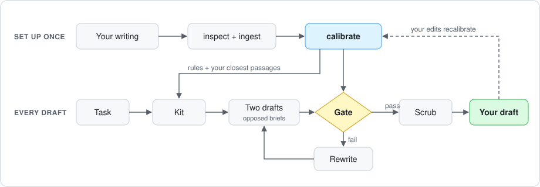

# Mimesis

Mimesis writes in a person's voice from their own writing. It calibrates on
that writing once and checks every draft against it before it ships: a
13-feature stylometric fingerprint, a scrubber for constructions that give
machine prose away, and a structural report. It runs locally as a Claude Code
MCP server and a CLI.

Prompted imitation fails stylometric verification: a classifier still separates
the imitation from the real author (arXiv:2603.29454, 2509.14543; short informal
registers, one model). Generation with a discriminator in the loop closes most
of the gap (2602.08934, 2503.08716). Mimesis generates candidates, scores each
one against the author's own corpus, and selects on that distance. The model's
opinion of its own output plays no part in the choice.

The repo ships with no personal data. The only profile checked in is a short
synthetic demo, and `profiles/*` is gitignored for everything else.

---

## How it works

<p align="center">
  
</p>

- **ingest** splits each document into ~180-word chunks and stores them in
  SQLite with a keyword index and local embeddings (bge-small, ONNX, no torch).
- **retrieve** fuses vector and keyword search and diversifies the results, so
  the anchors are different pieces of the author's writing, not five versions
  of one.
- **fingerprint** measures sentence-length spread, short and long sentence rates,
  punctuation densities, question rate, paragraph length, first-person openers,
  vocabulary range and word length, each z-scored against the author's corpus.
  `calibrate` prints a leave-one-out self-baseline: the distance of the author's
  own pieces from their corpus, and the floor for what "sounds like them" can mean.
- **gate** scores each candidate, keeps those inside the author's fit threshold,
  takes the Pareto front over fit and hard flags, and issues a targeted rewrite
  when nothing passes.
- **scrub** removes what is always safe for this author, flags the rest, and
  never rewrites toward the average. Hard flags cover constructions a reader
  rejected by name in blind testing and that measure near zero in human prose
  (`docs/DETECTORS.md`).
- **structure** reports coherence, openers, paragraph shape, cadence and
  vocabulary against bands measured on the author's documents. It informs the
  rewrite and never decides the ranking (`docs/STRUCTURE_GATES.md`).

Generation uses your Claude Code session (MCP) or the local `claude` CLI
(`mimesis compose`). No API keys and no cloud services beyond that.

---

## Quickstart

```bash
git clone https://github.com/pskeough/Mimesis_Voice_Clone.git
cd Mimesis_Voice_Clone
bash install.sh                                     # macOS / Linux
powershell -ExecutionPolicy Bypass -File install.ps1   # Windows
```

The installer creates a venv, installs the package, builds the demo voice,
registers the MCP server with Claude Code as `mimesis`, and runs a health check.
It is safe to re-run. `--skip-mcp` (`-SkipMcp`) leaves Claude Code's
configuration alone.

**Build your voice.** Open Claude Code in this folder and say "set up my voice".
It asks what you write, where the files are, and whether any were co-written or
AI-assisted, then inspects the folder, builds the voice and writes a test piece
for you to judge. Until you have a voice of your own, every writing tool
replies with these setup steps.

By hand:

```bash
mimesis inspect ~/Documents/my-writing
mimesis new myvoice --from ~/Documents/my-writing --author "Your Name"
mimesis purity myvoice          # pieces that read machine-written
mimesis add myvoice --from ~/more-writing      # add more later; always rebuilds
```

### What makes a good corpus

- **Only your own writing.** Leave out anything co-written, edited by someone
  else, or drafted with AI. The system calibrates against whatever it is given
  and cannot tell the difference.
- **About 40 pieces, or 20,000 words, per form.** Below 5,000 words the
  calibration is noise.
- **One voice per form.** Posts, essays and fiction each get their own voice
  (`jane-posts`, `jane-essays`). One fingerprint across forms measures format,
  not voice. A single book beside short pieces becomes the fingerprint.

---

## Using it from Claude Code

| Tool | Does |
|---|---|
| `list_voices` | voices, which is active, whether setup is needed |
| `inspect_corpus`, `create_voice` | build a voice from a folder of writing |
| `compose_slate`, `gate_candidates` | gated writing: Claude writes candidates, the gate scores and picks |
| `compose_in_voice` | a quick kit and protocol, no gate |
| `get_voice_guide`, `retrieve_style_examples`, `retrieve_transform_demos` | anchors on their own |
| `scrub_ai_footprint` | the final check on any draft |
| `eval_voice` | fingerprint distribution for a voice |
| `record_preference` | log a kept, rejected or corrected draft |

Pass `voice=` on every call. Write the two candidates from opposed structural
briefs: across about twenty gated sections, four candidates off one brief
covered 19-55% of the author's own variety, and two off opposed briefs covered
86-148%.

`docs/GLOBAL_CLAUDE.md` is an optional block for `~/.claude/CLAUDE.md` that
sends "write this in my voice" to these tools from any folder. `CLAUDE.md` is
the operating guide Claude Code reads in this folder.

---

## Evidence

`mimesis eval <voice> --held-out 5` mixes held-out real pieces with
generations written from neutral briefs, excludes the source piece and its
nearest neighbours from the anchors, and asks a `claude -p` judge which text is
real. The bar is generated RMS-z within 2x the corpus self-baseline.

| voice | self-baseline | held-out real | generated | ratio | fool-rate | n |
|---|---|---|---|---|---|---|
| creative | 0.934 | 0.559 | 0.911 (sd 0.205) | 0.97x | 80% | 5 |
| research | 1.017 | 0.973 | 0.978 (sd 0.142) | 0.96x | 80% | 5 |

I read the ratio as the more informative number. The fool-rate at n=5 rests on
four trials.

**What the fingerprint cannot see.** All thirteen features are order-invariant,
so shuffled sentences score the same as the original. `cadence.py` adds
order-aware features (`feature_set: "v2"`) that separate real from
rhythm-destroyed prose at AUROC 1.000, but as a generation gate they did not
beat v1 on a correctly segmented ruler, so they ship as a diagnostic
(`mimesis audit`). Details in `evals/CADENCE_FINDINGS.md`.

**Tried and discarded** (full campaign in `evals/REPORT.md`):

- *StyleDistance as the retriever.* Changed 91% of anchors, moved fit by at most
  0.006, and cut the creative fool-rate from 50% to 25%. Style-matched anchors
  are topically adrift.
- *Cadence features as the gate.* The effect fell from -0.613 (p=0.016) to
  -0.174 (p=0.45) once segmentation was fixed.
- *A perplexity detector in the loop.* Kept for reporting. Gating on it tunes
  prose to the detector.

What survived is recalibrating from accepted drafts (`mimesis accept`,
`mimesis recalibrate`): the author's edits are the only supervised signal the
system gets.

---

## Install extras

| extra | pulls | enables |
|---|---|---|
| _(base)_ | fastmcp, fastembed, numpy, python-docx, pypdf | the full engine |
| `[structure]` | spacy + `en_core_web_sm` | the opener line of the structure report; installed by default, ~50 MB |
| `[style]` | sentence-transformers, torch | StyleDistance embeddings |
| `[detect]` | transformers, torch | perplexity-ratio detector, reporting only |

`[style]` and `[detect]` pull torch, a multi-GB download.

---

## More

`CLAUDE.md` operating guide · `UPGRADE.md` upgrading an older install ·
`docs/DESIGN.md` design · `docs/DETECTORS.md` rhetorical detectors ·
`docs/STRUCTURE_GATES.md` structural measures · `docs/RESEARCH_WRITING.md`
research guidance packs · `evals/` evaluation harness and findings.

No fine-tuning, no detector evasion as a product claim, no cloud services.

Apache-2.0, see `LICENSE`.
